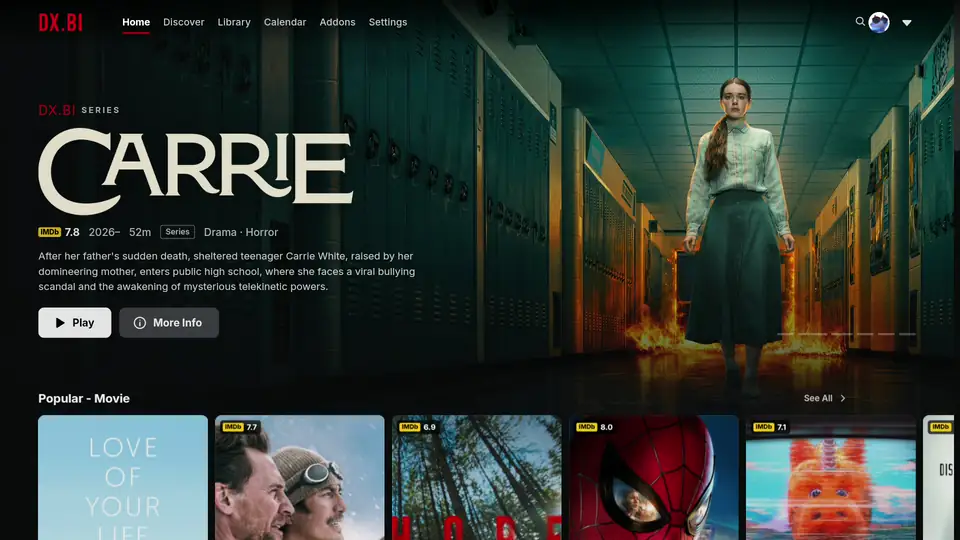
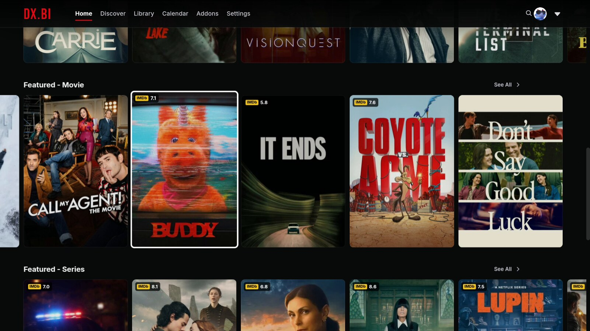
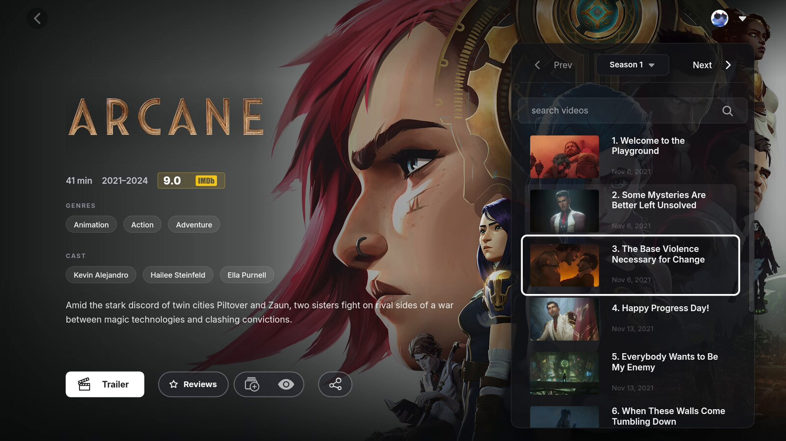
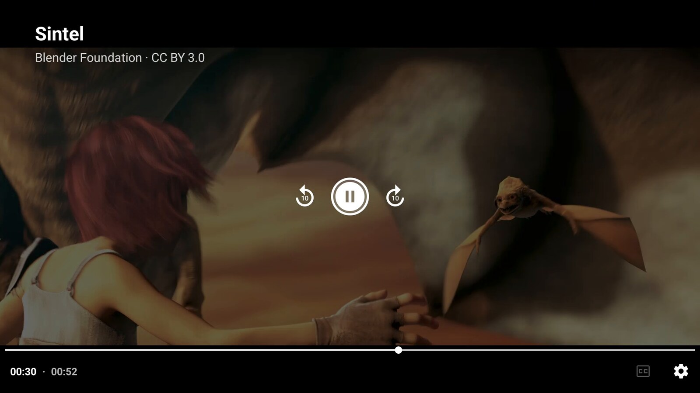
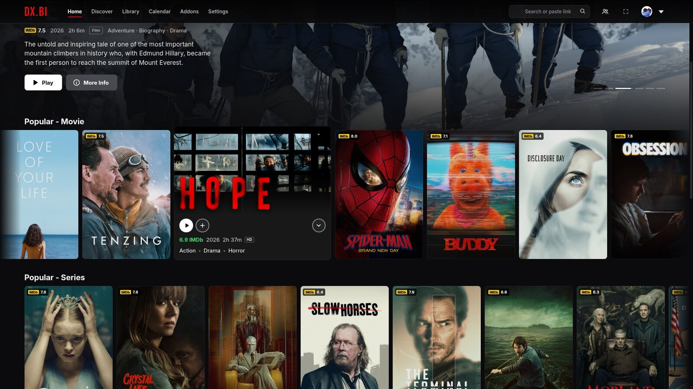
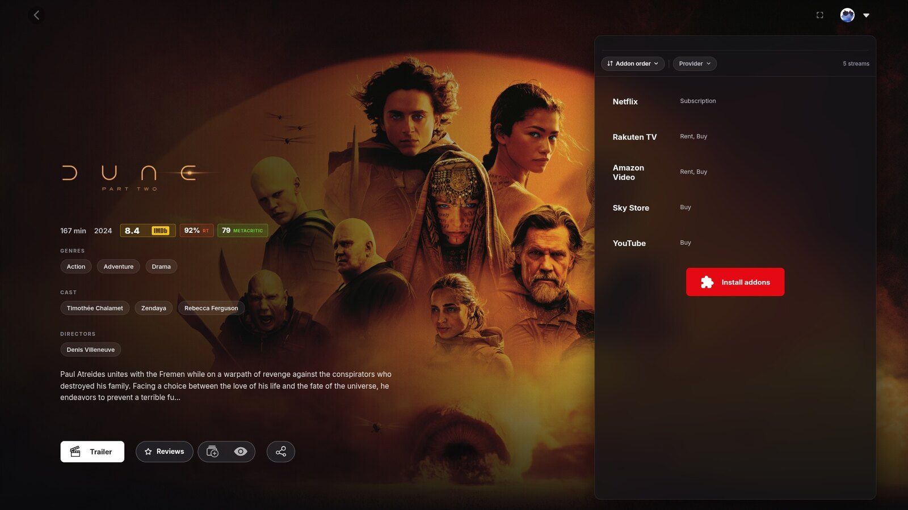
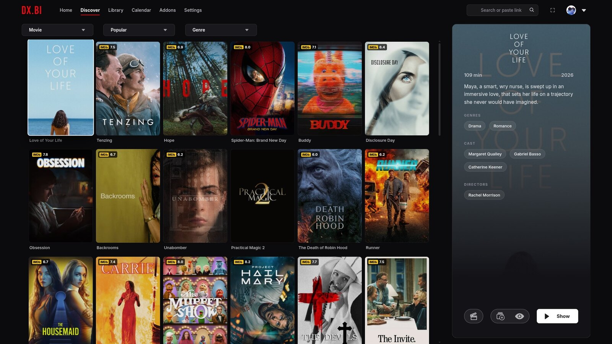

<p align="center">
  
</p>

<p align="center">
  <b>A Netflix-style Stremio app for Windows, macOS, Linux and TVs.</b><br>
  Download, sign in, done. Works with your existing addons. Nothing to configure.<br>
  <sub>Also available as a plugin for Stremio Enhanced.</sub>
</p>

<p align="center">
  <a href="#install"><b>⬇ Download dx.bi for Windows, Mac, Linux or your TV</b></a>
  &nbsp;·&nbsp;
  <a href="https://discord.gg/nnVBjqZ84F"><b>💬 Join the dx.bi Discord</b></a>
  &nbsp;·&nbsp;
  <a href="https://buymeacoffee.com/notdxbi"><b>☕ Support dx.bi</b></a>
</p>

<p align="center">
  <a href="https://github.com/notdxbi/dxbi-stremio/releases/latest"></a>
  
  <a href="NOTICE.md"></a>
  <a href="https://discord.gg/nnVBjqZ84F"></a>
  <a href="https://buymeacoffee.com/notdxbi"></a>
</p>

<p align="center">
  <a href="https://github.com/notdxbi/dxbi-stremio/releases/download/v2.15.9/dxbi-promo.mp4"><b>▶ Watch the 1-minute preview</b></a> (computer and TV)
</p>

<p align="center">
  
</p>

> [!NOTE]
> DX.BI is a personal fan project I made for my own use and decided to share. It was built with the help of [Claude Code](https://www.anthropic.com/claude-code), Anthropic's AI coding assistant. It isn't affiliated with Netflix or Stremio.

<br>

## Install

Pick your device below. It takes about two minutes.

| Device | Download |
|---|---|
| Windows 10 and 11 | [**Download for Windows**](https://github.com/notdxbi/dxbi-stremio/releases/latest/download/dxbi-Setup-x64.exe) |
| Mac with an Apple chip (M1, M2, M3, M4…) | [**Download for Mac (Apple chip)**](https://github.com/notdxbi/dxbi-stremio/releases/latest/download/dxbi-mac-arm64.dmg) |
| Mac with an Intel chip | [**Download for Mac (Intel)**](https://github.com/notdxbi/dxbi-stremio/releases/latest/download/dxbi-mac-x64.dmg) |
| Linux | [**Download for Linux**](https://github.com/notdxbi/dxbi-stremio/releases/latest/download/dxbi-linux-x86_64.AppImage) |
| Android TV, Google TV, Fire TV | [**See the TV steps**](#on-a-tv) |

Not sure which Mac you have? Click the Apple menu  → *About This Mac*. "Chip: Apple M…" means an Apple chip; "Processor: Intel" means Intel.

> [!TIP]
> You'll sign in with a Stremio account. If you don't have one yet, it's free: create it in the app when it asks, or at [stremio.com](https://www.stremio.com).

### On Windows

1. Open the file you downloaded (`dxbi-Setup-x64.exe`).
2. Windows may show *"Windows protected your PC"*, because dx.bi is a small free project without a paid publisher certificate. Click **More info**, then **Run anyway**.
3. dx.bi installs and opens by itself. It's then in your Start menu.
4. Sign in with your Stremio account.

dx.bi sets up Stremio's streaming server by itself (it's what plays torrents), and plays videos with its built-in mpv player, so every format plays as it is: HEVC, 10-bit, Dolby Vision, DTS and TrueHD sound, MKV.

<details>
<summary>Prefer not to install anything?</summary>
<br>

Download [`dxbi-portable-x64.exe`](https://github.com/notdxbi/dxbi-stremio/releases/latest/download/dxbi-portable-x64.exe) instead: it runs straight away, without installing.
</details>

### On a Mac

1. Open the file you downloaded (`.dmg`) and drag **dx.bi** into **Applications**.
2. Open dx.bi from Applications. macOS will say it can't check the app (dx.bi is a free project without a paid Apple certificate). Click **Done**.
3. Open **System Settings → Privacy & Security**, scroll down to *"dx.bi" was blocked*, and click **Open Anyway**. Confirm with your password.
4. dx.bi opens. Sign in with your Stremio account.

You only need steps 2 and 3 once.

<details>
<summary>macOS says dx.bi "is damaged and can't be opened"?</summary>
<br>

That's macOS being extra careful with apps downloaded from the internet. Open *Terminal* (in Applications → Utilities), paste this, press Enter, and open dx.bi again:

```bash
xattr -dr com.apple.quarantine /Applications/dx.bi.app
```
</details>

### On Linux

1. Right-click the downloaded `dxbi-linux-x86_64.AppImage` → *Properties* → *Permissions*, and tick **Allow executing file as program** (or run `chmod +x dxbi-linux-x86_64.AppImage`).
2. Double-click it to open dx.bi, and sign in with your Stremio account.

<details>
<summary>It doesn't open?</summary>
<br>

Some distributions need *FUSE* for AppImages. On Ubuntu and Debian: `sudo apt install libfuse2`. On a Raspberry Pi or another ARM computer, download [`dxbi-linux-arm64.AppImage`](https://github.com/notdxbi/dxbi-stremio/releases/latest/download/dxbi-linux-arm64.AppImage) instead.
</details>

### On a TV

dx.bi TV runs on Android TV, Google TV and Fire TV (Fire TV Sticks, Cubes and Fire TV televisions), and on TCL, Sony, Hisense and other TVs that run Google TV or Android TV. Everything works with the remote: the arrows move around, OK opens, Back goes back.

**1. Install Downloader.** On the TV, search for *Downloader* (by AFTVnews) in the Play Store or Amazon's Appstore, and install it.

**2. Let Downloader install apps.**
- Fire TV: *Settings → My Fire TV → Developer options → Install unknown apps* → turn **Downloader** on. (No *Developer options*? Go to *Settings → My Fire TV → About*, click your device's name 7 times, then go back.)
- Android TV and Google TV: Downloader asks for permission the first time you install something. Choose **Settings**, turn it on, and go back.

**3. Download dx.bi.** Open Downloader, select the address box and type:

```
github.com/notdxbi/dxbi-stremio/releases/latest/download/dxbi-tv.apk
```

Select **Go**. When the download finishes, choose **Install**, then **Open**.

**4. Sign in** with your Stremio account. dx.bi is now in your TV's apps.

Good to know:

- Your watch progress is shared with every other Stremio app, so you can start something on the TV and finish it on your computer.

- Debrid streams and torrents both play straight away: dx.bi TV downloads torrents itself, so no computer or streaming server is needed. On a slow stick you can hand torrents to the dx.bi app (or Stremio) on a computer instead: keep it running on the same network, then on the TV open *Settings → Streaming server for torrents → Find*. If Windows asks whether to let dx.bi use private networks, allow it.

- Not supported: LG (webOS), Samsung (Tizen), Roku and Apple TV can't install Android apps. A cheap Google TV or Fire TV stick plugged into one of them works. The 2025 *Fire TV Stick 4K Select* runs Amazon's Vega OS instead of Fire OS and can't install dx.bi either.

- If dx.bi says the TV needs an update, update *Android System WebView* from the Play Store (on Fire TV: *Settings → My Fire TV → About → Check for Updates*).

### After installing

dx.bi keeps itself up to date. On Windows and Linux it downloads new versions in the background and offers to restart; on a Mac it tells you and you download the new version; on a TV it offers the update when it starts.

- **Already used Stremio Enhanced?** The first time the computer app opens, it offers to copy your sign-in, library, settings and plugins over. Stremio Enhanced itself isn't changed.

- **New to Stremio?** dx.bi shows films and series from your *catalog addons*, and plays them from your *stream addons*. On a new account it offers to add free catalogs for a full Home. For streams, open *Addons* and add one you like from the community list; many people use them with a debrid service such as [Real-Debrid](https://real-debrid.com/). What you watch and where it comes from is your responsibility, so please follow the laws where you live.

<br>

## Read this first

> [!IMPORTANT]
> DX.BI is a Stremio app: it uses your Stremio account and addons. It doesn't add any movies, shows or streams of its own, and it doesn't make anything play on its own.
>
> Titles play the way they do in Stremio. If nothing plays in your Stremio today, nothing will play in DX.BI either.

<br>

## Already using Stremio Enhanced? Use the plugin

You can add dx.bi to [Stremio Enhanced](https://github.com/REVENGE977/stremio-enhanced/releases) as a plugin instead of installing the app. You get the same dx.bi. The plugin is made and tested on Stremio Enhanced's latest full release, currently 1.2.0; preview and test builds (such as 1.3.0-preview) aren't supported and can break the player.

1. Run one command. On Windows, open *PowerShell* and paste:

   ```powershell
   irm https://github.com/notdxbi/dxbi-stremio/releases/latest/download/install.ps1 | iex
   ```

   On macOS or Linux, open *Terminal* and paste:

   ```bash
   curl -fsSL https://github.com/notdxbi/dxbi-stremio/releases/latest/download/install.sh | bash
   ```

2. Restart Stremio Enhanced.

3. Go to *Settings → Enhanced* and switch the dx.bi plugin on. The theme is built into the plugin, so that's all you need.

Updates are offered automatically inside Stremio Enhanced.

<details>
<summary>Prefer to install the plugin by hand?</summary>
<br>

1. Download [`dxbi.plugin.js`](https://github.com/notdxbi/dxbi-stremio/releases/latest/download/dxbi.plugin.js).
2. In Stremio Enhanced, go to *Settings → Enhanced*, open *Open Plugins Folder* and put the file there.
3. Restart and switch the plugin on.

The look is built into the plugin, so no theme file is needed. Applying any other theme switches the built-in one off.
</details>

<br>

## What you get

<p align="center">
  
</p>

### Browsing

<p align="center">
  
</p>

- **Cinematic intro** — plays once at startup with its own sound. Press <kbd>Esc</kbd> to skip.

- **Rotating billboard** — a big banner on Home with title art, rating, synopsis, Play and More Info.

- **Netflix-style rows** — scroll sideways with arrows.

- **Hover previews** — rest on a title and its card unfolds with a soft glow while the row makes room, showing its rating, genres and trailer. One click takes the trailer full screen.

- **Keyboard browsing** — get around everything with the arrow keys. The pointer hides while you do, the title you land on previews just like a hovered one, rows turn to their next page at the edge, and moving the mouse hands control straight back.

- **Ratings on posters** — IMDb scores from your own addons. Anime gets its Kitsu or AniList score.

- **Reviews on title pages** — Rotten Tomatoes and Metacritic scores beside the IMDb rating, and a Reviews button with what critics said. Works without an account; free keys add audience reviews and more scores.

- **Wide Continue Watching** — landscape cards with title art and progress.

- **My List on Home** — your library as a row under Continue Watching, or separate rows for films and shows.

- **Customise Home** — move, hide or rename any Home row, whichever addon it comes from. In your profile menu (on TV, also in *Settings*), saved per viewer.

- **Sharper posters** — bigger posters load when your screen can show them. On a TV, only the title you're on.

- **Colours from the title** — a title's page and player take a colour from its artwork, always in a shade white text reads on. Black and white films keep your accent.

- **Watched titles** — optionally dim or hide what you've already seen in Discover, Search and Home.

### The player

- **Plays everything on Windows** — the app plays videos with mpv, like Stremio's own app: HEVC, 10-bit, Dolby Vision, AV1, DTS and TrueHD, MKV and embedded subtitles, with hardware decoding and no converting. Switch it off under *Play videos with mpv*.

- **Redesigned controls** — seek-bar thumbnails, time remaining, ±10 seconds, Next Episode, and clean subtitle and speed menus. The title shortens rather than ever covering a button.

- **Picture & sound panel** — the sliders button in the player:
  - remove black bars that are part of the video (great on ultrawide screens), or zoom in
  - Dialogue boost and Night mode, for quiet speech and loud explosions
  - sync subtitles by clicking the line you just heard
  - a second subtitle language on top, handy for learning a language

- **Picture enhancement** — real-time upscaling on your graphics card. [Anime4K](https://github.com/bloc97/Anime4K) for anime, sharpening for movies.

- **Stream stats** — press <kbd>D</kbd> or the chart button: resolution, codecs, HDR, bitrate, buffer, dropped frames and live download speed for every stream, with peers for torrents. Replaces Stremio's torrent-only statistics.

- **Skip Intro and Next Episode** — buttons from community skip databases, for movies, series and anime.

- **Up next** — a countdown to the next episode when the credits roll. The next episode is loaded in advance so it starts sooner.

- **Open in mpv or VLC** — for files that won't play or stutter here.

- **The time in the player** — the time now and when this ends, top right with the controls, on desktop and TV.

- **Picture-in-picture** — keep watching in a small window.

- **Keyboard controls** — press <kbd>Enter</kbd> to step into the player's buttons and menus, move with the arrows, and press <kbd>Esc</kbd> to step back out.

- **Remembers volume and speed** — and keys <kbd>0</kbd>–<kbd>9</kbd> jump through a video. Press <kbd>?</kbd> for every shortcut.

### On your TV

<p align="center">
  
</p>

- **Made for the remote** — a clear ring shows what's selected and moves the moment you press (pick white, your accent colour or yellow). Holding a direction moves at a steady pace, and See All sits at the end of every row.
- **Android's own player** — smooth playback on TV hardware, ±10 s with left and right, and subtitles drawn the way you set them in Stremio (size, colour, outline, position).
- **Light on cheaper sticks** — no heavy effects, a small built-in plugin, and hover cards off by default (switch them on in dx.bi settings).
- **Search boxes don't trap the remote** — the arrows move past them; press OK to type.
- **Skip intro, recap and credits** — a *Skip* button in the TV player (OK presses it), or skipping by itself if you choose in dx.bi settings.
- **Torrents play on the TV itself** — no computer or streaming server needed. The player shows peers and speed while it gets going. You can still use a computer's streaming server instead (*Settings → Streaming server for torrents → Find*).
- **dx.bi settings in sections**, at the top of Stremio's *Settings*.

<table>
  <tr>
    <td></td>
    <td></td>
    <td></td>
  </tr>
  <tr>
    <td align="center"><sub>Home</sub></td>
    <td align="center"><sub>Seasons and episodes</sub></td>
    <td align="center"><sub>The TV player</sub></td>
  </tr>
</table>

### Series and anime

- **Anime filler guide** — filler episodes marked in long anime, with an option to skip them.

- **New episode badges** — on shows in your library.

- **Airing this week** — a Home row with countdowns to upcoming episodes.

### Your library and addons

- **Library sorting** — newest, oldest or top rated, plus a genre filter. Stremio's *Watched* and *Not watched* really filter the list.

- **Stream sorting and filters** — by quality, seeds, size, language, source, provider, instant (cached) and HDR.

- **Addon order and backup** — reorder, back up and restore your addons.

### Together and personal

- **Watch party** — watch in sync with friends, with chat and reactions. End-to-end encrypted.

- **Discord status** — show what you're watching on Discord, with time left (the app, under *Discord Rich Presence*).

- **Report a problem** — in your profile menu (on TV: top of *Settings*). Describe what went wrong and dx.bi sends the details that help fix it, with a code to mention in Discord. No e-mail, passwords, keys or stream links are sent.

- **Who's watching?** — separate viewers, each with their own stats, volume and hidden titles.

- **Kids profiles** — in *Who's watching? → Manage viewers*, make any viewer a kids profile, up to age 7, 12 or 15. It only shows titles rated for that age (films' certificates, anime ratings, and series ratings with a free TMDB key), the billboard switches to family titles, and Settings and Addons are out of reach. Set a parental PIN so kids can't switch to another profile. A grown-up can let a title through with *Allow for kids* on its page.

- **Hide titles** — hide anything you never want to see again from its hover card or its page. Bring it back from *Manage viewers → Hidden titles*.

- **Your stats** — hours watched, streaks, top titles and genres, in your profile menu.

- **Look and feel** — every page restyled, 8 accent colours, soft interface sounds, and an on/off switch for every feature.

<br>

<table>
  <tr>
    <td></td>
    <td></td>
  </tr>
  <tr>
    <td align="center"><sub>Hover preview</sub></td>
    <td align="center"><sub>Movie page</sub></td>
  </tr>
  <tr>
    <td></td>
    <td></td>
  </tr>
  <tr>
    <td align="center"><sub>Series page</sub></td>
    <td align="center"><sub>Discover</sub></td>
  </tr>
  <tr>
    <td></td>
    <td></td>
  </tr>
  <tr>
    <td align="center"><sub>Player with seek-bar preview</sub></td>
    <td align="center"><sub>Two subtitle languages at once</sub></td>
  </tr>
</table>

<p align="center"><sub>Player shots use <a href="https://durian.blender.org/">Sintel</a> (© Blender Foundation, CC BY 3.0).</sub></p>

<br>

## A closer look

### Watch party


1. Click the people button (top right, or in the player), enter your name and choose *Start a party*.

2. Copy the code and send it to your friends. They paste it under *Join*.

3. Play anything. Each friend's Stremio opens the same title, picks the same release from their own addons, and jumps to your spot.

Once you're watching:

- anyone can pause, play or skip, and it happens for everyone
- if someone is buffering, everyone waits for them
- the party follows the host to the next episode
- chat and reactions appear in the player

Stream links are never shared, because debrid links contain your API key. Friends only receive the title, the release's torrent hash and the playback position. Everything is end-to-end encrypted with the party code and passed through public relays that only see scrambled data. No account and no server to run.

Each friend needs dx.bi on a computer (the app, or the plugin in Stremio Enhanced), plus their own stream addon. If they don't have the exact release, the closest match is used.

<br clear="right">

### Picture & sound panel

Click the sliders button in the player.

<p align="center">
  
</p>

- **Picture** — *Remove black bars* measures the picture and crops off bars that are part of the video file, such as a widescreen film inside a 16:9 file. You can also zoom to 110%, 125% or 133%. Stremio's own Fit / Crop / Stretch button still works on top.

- **Sound** — *Dialogue boost* lifts voices and the centre speaker. *Night mode* also evens out loud and quiet scenes, so you can keep the volume down. Both work with 5.1 and stereo.

- **Subtitle sync** — shows the lines around the current moment. Click the line you just heard and the subtitles move to match. Fine-tune with ±0.25 s.

- **Second subtitles** — choose another language to show at the top of the picture.

<p align="center">
  <br>
  <sub>Remove black bars, on a 21:9 ultrawide screen</sub>
</p>

<p align="center">
  <br>
  <sub>Subtitles 4 seconds late, fixed with one click</sub>
</p>

### Reviews


Every movie and show page gets critics' scores next to its IMDb rating, and a *Reviews* button beside *Trailer*.

- *Scores*: Rotten Tomatoes and Metacritic, from Wikidata.
- *What critics said*: the critics' summary from the title's Wikipedia article, with a link to read more.

That works for everyone with no setup. Two free keys add more, and each one is only ever sent to its own service:

- A *TMDB key* adds audience reviews. Sign up at [themoviedb.org](https://www.themoviedb.org/signup), open *Settings → API*, and paste the API key or the read access token.
- An *MDBList key* adds fresher scores, including Rotten Tomatoes audience, Letterboxd and Trakt (1,000 titles a day). Sign in at [mdblist.com](https://mdblist.com), open *Preferences*, and copy the API key.

Paste them under *Reviews* in dx.bi's settings, then press *Close* to save.

<br clear="right">

### Picture enhancement

Makes anime, especially older or lower-resolution episodes, look cleaner and sharper.

- *Anime4K* runs the real [Anime4K](https://github.com/bloc97/Anime4K) v4 restore and upscale shaders by bloc97.
- *Sharpen* gives live action a crisp upscale.
- *Auto* uses Anime4K for anime and Sharpen for everything else.

HDR keeps its correct colours, subtitles stay on top, and it steps down by itself if your graphics card can't keep up. Switch it in the settings or with the ✨ button in the player.

### Stream sorting and filters


A bar above every list of streams:

- sort by addon order, quality, seeds or size
- filter by quality (4K, 1080p, 720p, SD)
- by language, read from flags and release names
- by source (Remux, BluRay, WEB, HDTV)
- by provider, when you have more than one stream addon
- instant only (cached debrid links), and HDR / Dolby Vision

It reads what your addons already show, so it works with any stream addon. Your choices are remembered.

<br clear="right">

<br>

## Settings

In the app, open *Settings → dx.bi → Plugins → dx.bi → ⚙* (*Settings → Enhanced → …* with the plugin). On a TV, *dx.bi settings* is at the top of Stremio's *Settings*. Changes apply instantly.


The settings are grouped, with a list to jump between groups and a search box:

- **Look** — accent colour, the TV's selection highlight, built-in theme, ratings, wide Continue Watching
- **Home** — billboard and its content and speed, video-only rows, new episode badges, airing row, Who's watching?
- **Hover cards & trailers** — previews, trailers and their delay
- **Browsing & library** — watched titles, library sorting, stream sorting, addon tools, watch stats, reviews and their keys
- **Player** — player extras, time remaining, seek-bar previews, picture enhancement, the Picture & sound panel, stream stats, remember volume and speed, shortcuts, picture-in-picture, Open in mpv / VLC, converting
- **Subtitles** — style, font, whether they start on, HDR
- **Episodes & skipping** — skip buttons and auto-skip, up next, next episode ready, filler guide
- **Watch party** and **Intro & sounds**

<br clear="right">

For a custom subtitle font on desktop, choose *Subtitles → Subtitle font → Custom installed font* and enter its family name in *Custom subtitle font* (for example, *Tahoma* or *Noto Naskh Arabic*). The font must be installed on your computer. This applies to the built-in mpv player and browser subtitles; picture-based subtitles and ASS subtitles with original styling enabled keep their own appearance.

<br>

## Everything built in

Everything is part of dx.bi, written from scratch so nothing clashes. The app and Stremio Enhanced can also load other people's plugins, but these do the same jobs as dx.bi, so leave them off or things will show twice:

> TheIntroDB, IntroDB, Stremio Intro Skip, AniSkip, Stremio Addon Manager, Addon Organizer, Enhanced Video Player, Picture in Picture, Context Menu Fix, Dynamic Hero, Horizontal Navigation, EnhancedCovers, Enhanced Title Bar, and [Lumen](https://github.com/echodzns04/echo-stremio-plugins).

Plugins that do something DX.BI doesn't (for example library folders or random pick) work alongside it. Any addons work: DX.BI uses whatever yours provide.

<br>

## FAQ

### I installed it but nothing plays

DX.BI doesn't provide any streams (see [Read this first](#read-this-first)). Playback comes from your stream addons.

### It looks half-styled

Check that *dx.bi look built in* is on in dx.bi's settings, that no other theme is applied, and that the plugins listed above are off. With Stremio Enhanced, also check that the dx.bi plugin is switched on.

### My Home has different rows from the screenshots

Home's rows come from the catalog addons on your account, not from DX.BI. On a fresh account DX.BI offers once to add the free catalogs its own Home uses: Streaming Catalogs, Anime Catalogs (MyAnimeList top series and films, with anime search) and TMDB Collections (popular and top rated). No accounts or keys needed. You can add or undo them any time from *Addons → Order & backup*. Stream addons are your own choice and are never added.

### "Video is not supported"

Stremio couldn't play that file, and DX.BI shows why underneath. Usually it's one of two things:

- Stremio's streaming server isn't running. Torrents and formats like MKV, HEVC and Dolby Vision need it. Restart dx.bi (or Stremio Enhanced) and let it set the streaming server up. *Settings → Streaming* shows whether it's online.
- The format doesn't play on that computer. The Windows app plays these with mpv (check *Play videos with mpv* is on). On a Mac, on Linux and with the plugin, DX.BI has the streaming server convert them automatically. If it still fails, pick an x264 or WEB-DL release, or use *Open in mpv / VLC*.

### Windows: "Probe process exited with code: 3221225781"

Windows couldn't start the streaming server's video tool (ffprobe) because a file it needs is missing. To fix it, try these in order:

- Restart dx.bi. When it starts, it checks the streaming server's ffmpeg and ffprobe and replaces copies that can't run. This includes Stremio Service's: its Windows download comes without the files its ffprobe needs. (With the plugin in Stremio Enhanced, nothing repairs Stremio Service, so choose server.js instead.)
- Using server.js, you can also close dx.bi and delete `ffmpeg.exe` and `ffprobe.exe` in `%APPDATA%\dxbi\streamingserver` (`%APPDATA%\stremio-enhanced\streamingserver` with the plugin). Fresh copies are downloaded on the next start.
- If you've installed ffmpeg yourself, dx.bi uses that copy first when it's on your PATH. Update it or remove it from the PATH.

### A green screen says "Torrent is being downloaded to debrid…"

That release isn't cached on your debrid service yet. It's a short clip from your stream addon, not a DX.BI error. Pick a release marked RD+ or ⚡ to watch straight away.

### Subtitles turn on by themselves

Not any more. *Subtitles when a video starts* is Off by default, like Netflix. Turn them on from the player's subtitles menu, or choose *On, in my Stremio subtitle language* in the settings.

### How do I remove it?

The app: uninstall it like any other app (on Linux, delete the AppImage). Your data is in `%APPDATA%\dxbi`, `~/Library/Application Support/dxbi` or `~/.config/dxbi`.

The plugin: switch it off and apply the *Default* theme. Nothing else is changed.

### Does it collect anything?

No tracking and no accounts. It only asks public services about the titles you're looking at, never about you:

- ratings and artwork: Cinemeta, MetaHub, Kitsu, AniList
- skip times: TheIntroDB, AniSkip
- filler lists: animefillerlist.com
- reviews: Wikidata and Wikipedia; TMDB and MDBList only if you add your own key
- trailers: YouTube (privacy-enhanced mode, only while a trailer plays)
- fonts: Google Fonts and jsDelivr

Watch stats and viewers stay on your computer. *Order & backup* talks to Stremio's own servers only when you press Save or Restore. Watch parties only connect while you're in one, and are end-to-end encrypted.

### A giant black arrow covers the video and every click goes back

With the plugin, that comes from a preview build of Stremio Enhanced (the dx.bi app isn't affected). Install the latest full release (currently 1.2.0) from its [releases page](https://github.com/REVENGE977/stremio-enhanced/releases), skipping anything marked Pre-release. Since 2.10.6 DX.BI also keeps that arrow small on its own.

### Does it work on my phone or TV?

On Android TV, Google TV and Fire TV, yes: see [On a TV](#on-a-tv). The same APK also installs on Android phones and tablets, upright or sideways. Upright, it has a phone layout with the tabs in a bar at the bottom. iPhones, iPads, LG (webOS) and Samsung (Tizen) TVs aren't supported.

### A friend can't connect to a party

Check that you both typed the same code and are on dx.bi 2.6.0 or newer. Parties use several relays, including one on the normal web port, so they work on most networks.

### Something overlaps after a Stremio update

Stremio changes its interface now and then. Post it in **#bug-reports** on the [dx.bi Discord](https://discord.gg/nnVBjqZ84F) or [open an issue](https://github.com/notdxbi/dxbi-stremio/issues), with a screenshot.

<br>

## Licence

dx.bi is free and open source under the [GNU GPL, version 3 or later](LICENSE): you can use, study, change and share it, and anything you share that's based on it must keep the credit and publish its full source under the same licence. Versions up to 2.15.9 were MIT. The "dx.bi" name and logo aren't part of the licence: please give forks their own name. Details, and the parts by others that keep their own licences, are in [NOTICE.md](NOTICE.md).

<br>

## Credits

- [Stremio](https://www.stremio.com/) ([stremio-web](https://github.com/Stremio/stremio-web)) — the app underneath everything.
- [Stremio Enhanced](https://github.com/REVENGE977/stremio-enhanced) by REVENGE977 — the open-source desktop client the dx.bi app is built on (MIT, [app/LICENSE.md](app/LICENSE.md)), and the home of the dx.bi plugin.
- The plugin authors whose work showed what Stremio users want — TheIntroDB, Sul-404 (Addon Manager), Fxy and MrBlu03.
- [Anime4K](https://github.com/bloc97/Anime4K) by bloc97 — the shaders behind Picture enhancement, included unmodified under the MIT licence ([LICENSE-ANIME4K](LICENSE-ANIME4K)).
- Cinemeta and MetaHub for metadata and artwork; [Kitsu](https://kitsu.app) and [AniList](https://anilist.co) for anime scores; [TheIntroDB](https://theintrodb.org) and [AniSkip](https://aniskip.com) for skip times; [animefillerlist.com](https://www.animefillerlist.com) for the filler guide; [Wikidata](https://www.wikidata.org) (CC0) and [Wikipedia](https://en.wikipedia.org) (CC BY-SA) for review scores and critics' summaries; [MDBList](https://mdblist.com) for extra scores. Audience reviews come from [TMDB](https://www.themoviedb.org): this product uses the TMDB API but is not endorsed or certified by TMDB.
- Fonts: [Bebas Neue](https://github.com/dharmatype/Bebas-Neue) and [Inter](https://rsms.me/inter/) (SIL Open Font License).
- Country flags: [Twemoji](https://github.com/jdecked/twemoji) graphics (CC-BY 4.0) via the [Twemoji Country Flags](https://github.com/talkjs/country-flag-emoji-polyfill) font by TalkJS (MIT).
- Built with the help of [Claude Code](https://www.anthropic.com/claude-code).

<sub>Inspired by the Netflix interface; no Netflix logos, fonts, images or sounds are used. The intro and all sounds are original (see <a href="tools">tools</a>). Not affiliated with Netflix, Inc., Stremio, Stremio Enhanced or any plugin author. <a href="CHANGELOG.md">Changelog</a> · <a href="NOTICE.md">Licence: GPL-3.0-or-later</a>.</sub>
